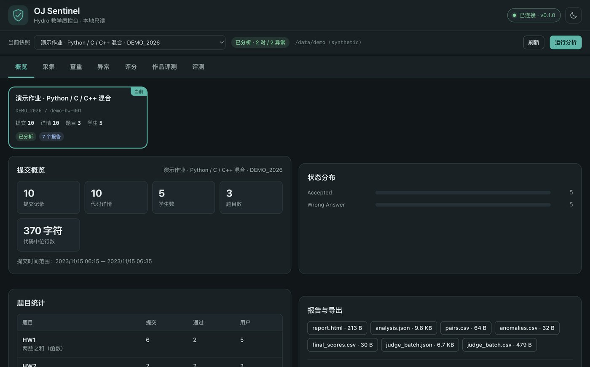
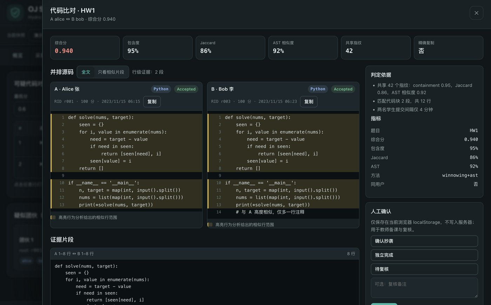
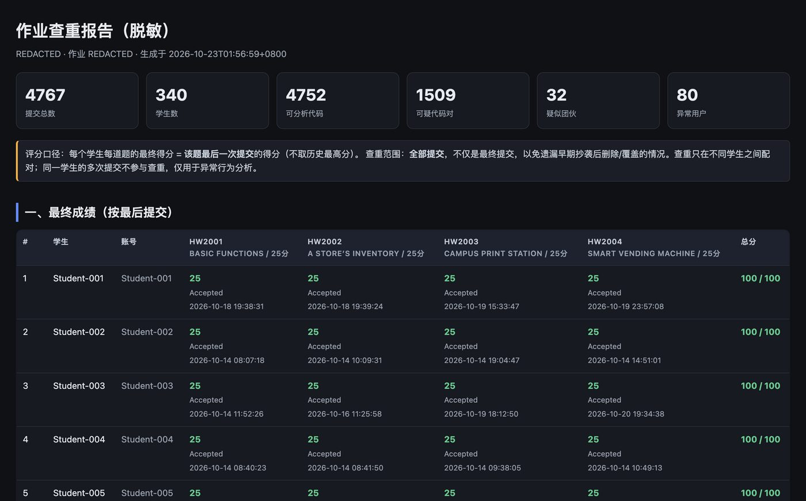

# OJ Sentinel

> Hydro OJ 作业数据采集 · 多语言代码查重 · 异常行为分析 · 本地评测 / AI 评测 · 跨平台 GUI

OJ Sentinel（OJ 哨兵）是一个面向课程 OJ（默认支持 Hydro v4）的教学质控工具。教师输入 OJ 地址、域名与账号后，工具会自动发现作业、题目、测试数据和全部学生提交，随后在本地完成：

- **多算法查重**：winnowing 指纹 + token n-gram + Python AST / C/C++ 结构特征 + 可选 AI 语义复核；不把学生代码上传到第三方。查重只在**不同学生**之间配对；同一学生的多次提交只进入异常行为分析。
- **异常行为检测**：短时间批量提交、提交间突变、首次提交即通过、AI 生成/粘贴特征、跨用户同源代码。
- **AI 智能分析**：默认使用 [DeepSeek Harness (dsh)](https://github.com/tzhazuma/dsh-android) 作为 agent；模型可自定义（默认 `opencode-go-2 / deepseek-v4.1-flash`）。
- **本地评测**：读取 OJ 测试数据，支持 Python / C / C++ 编译运行；可单条、批量（按题目或全部提交）评测，并与 OJ verdict 交叉验证；AI 生成补充测试、对失败提交给出纠错建议。
- **作品 / 小游戏 AI 评测**：对 OJ 无法自动判分的开放式作业（小游戏、项目）按 rubric 给出 AI 评分、逐项理由、证据与置信度，并强制标注“需人工复核”；教师保留最终分数决定权。
- **成绩口径**：每个学生每道题的最终得分 = 该题**最后一次提交**的得分；查重则覆盖**全部提交**，避免遗漏。
- **跨平台**：Web GUI、macOS/Windows/Linux 桌面应用、Android App。

> 隐私：学生姓名、账号、代码和测试数据只保存在本机 `data/`；该目录已被 `.gitignore` 排除。报告默认支持匿名化导出。







## 验证摘要（真实作业，2026-10）

- 采集 4,767 条提交 / 340 名学生 / 4 道题；4752 份可分析代码。
- 查重：1,509 组跨学生可疑对（同一对学生只保留最强证据），32 个近复制簇；Top pair 为 131 行归一化后完全一致，另有 52 对提交互相印证。
- 行为异常：80 名高置信度线索（六类信号，已按班级规模校准）。
- 本地评测：120 条分层抽样提交与 OJ verdict **120/120 一致**（Python，含 Hydro checker 包装）；C/C++ 编译运行路径有测试覆盖。
- AI：DSH（opencode-go-2 / deepseek-v4.1-flash）真实跑通可疑对复核、失败诊断、AI 测试生成（3/3 通过 5 份 accepted 参考校验）与贪吃蛇小游戏 rubric 评测（85/100，`needs_human_review=true`）。

## 快速开始（开发者）

```bash
git clone https://github.com/tzhazuma/oj-sentinel.git
cd oj-sentinel
python3.12 -m venv .venv && . .venv/bin/activate
pip install -e ".[dev]"
pytest -q

# 采集（密码从环境变量读取，不落盘）
export OJ_PASSWORD='...'
ojs acquire --url http://YOUR_HYDRO_HOST --domain YOUR_DOMAIN \
  --username YOUR_USERNAME --homework YOUR_HOMEWORK_ID
ojs analyze --homework YOUR_HOMEWORK_ID
ojs report --homework YOUR_HOMEWORK_ID --open

# 本地评测：单条 / 批量（本题 / 全部提交）
ojs judge --homework YOUR_HOMEWORK_ID --rid <rid>
ojs judge --homework YOUR_HOMEWORK_ID --problem HW2001 --limit 100
ojs judge --homework YOUR_HOMEWORK_ID --all --output data/judge_all.json

# AI 复核一对可疑提交 / 失败诊断 / 小游戏作品评测
ojs ai review --homework YOUR_HOMEWORK_ID --pair-index 0
ojs ai diagnose --homework YOUR_HOMEWORK_ID --rid <rid>
ojs ai evaluate-game --provider dsh --assignment examples/game_project/README.md \
  --rubric examples/game_project/rubric.md --files examples/game_project/snake_game.py

ojs serve
```

打开 <http://127.0.0.1:8765> 使用 Web GUI。

> 本仓库不包含任何真实账号、密码、学生数据或测试数据。示例中的地址/账号仅用于说明。

## 命令

| 命令 | 作用 |
| --- | --- |
| `ojs login` | 验证登录并列出域名信息 |
| `ojs homeworks` | 列出可访问作业 |
| `ojs acquire` | 采集作业、题目、测试数据、成绩单与全部提交 |
| `ojs ingest` | 将快照写入 SQLite 索引 |
| `ojs analyze` | 查重 + 异常行为 + 聚类，输出 JSON |
| `ojs report` | 生成 HTML/CSV/JSON 报告 |
| `ojs judge` | 单条 / 批量本地评测 + OJ 交叉验证（`--all` 全部提交） |
| `ojs ai` | AI 复核 / 诊断 / 测试生成 / 作品与游戏 rubric 评测 |
| `ojs serve` | 启动 Web GUI |
| `ojs desktop` | 启动桌面壳 |

## 文档

- [方法与阈值](docs/METHOD.md)（查重分数、理由、异常信号、局限）
- [C/C++ 课程支持](docs/C_CPP.md)
- [隐私与数据处理](docs/PRIVACY.md)
- [构建与安装包](docs/BUILD.md) · [Android](docs/ANDROID.md) · [AI/DSH 配置](docs/ai-setup.md)
- [开源查重工具与 AI 代码检测调研](docs/research/landscape.md)

## 架构

```
Hydro OJ ──HTTP──> hydro/ (login, parse, snapshot)
                         │
                    data/ snapshots + SQLite
                         │
        ┌────────────────┼─────────────────┐
   analysis/          judge/             ai/
 (winnowing/AST/   (local runner,     (dsh / OpenAI-
  behaviour)        cross-validate)    compatible)
        └────────────────┴─────────────────┘
                         │
              report/ + server/ (FastAPI + Web UI)
                         │
          desktop (pywebview) / Android (WebView + dsh)
```

## 开源查重工具对照

| 工具 | 算法 | 是否上传代码 | 本项目的取舍 |
| --- | --- | --- | --- |
| [MOSS](https://theory.stanford.edu/~aiken/moss/) | winnowing 指纹 | 是（Stanford 服务器） | 借鉴 winnowing；本地实现，不上传 |
| [JPlag](https://github.com/jplag/JPlag) | token/结构 + 贪心串匹配 | 否（可自建） | 借鉴 token 归一化与 greedy string tiling |
| [Dolos](https://github.com/dodona-edu/dolos) | 指纹 + 可视化 | 否（可自建） | 借鉴指纹与配对浏览体验 |
| [Codequiry](https://codequiry.com/) | 商业 MOSS 类 | 是 | 不采用 |

## License

MIT. 仅用于课程教学与学术诚信辅助；使用前请遵守所在学校与 OJ 的隐私政策。
